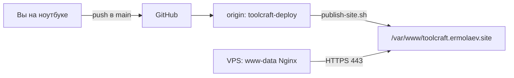

# Деплой Toolcraft на `toolcraft.ermolaev.site`

Публикация example-приложений: сборка monorepo и выкладка на origin.  
Инфраструктура (DNS, SAN, Nginx на origin и VPS) — в репозитории server:  
`G:\domains\server\servers\toolcraft.ermolaev.site.md` (локально) / `servers/toolcraft.ermolaev.site.md` в том репозитории.

## Цель

| Что | Значение |
| --- | --- |
| Домен | `toolcraft.ermolaev.site` |
| URL приложения | `https://toolcraft.ermolaev.site/demos/<имя-папки>/` |
| Пример | `https://toolcraft.ermolaev.site/demos/glass/` |
| Origin root | `/var/www/toolcraft.ermolaev.site/` |
| Выкладка | GitHub Actions → self-hosted runner на origin (`toolcraft-deploy`) |

В каждом example Vite `base` на build/preview: `/demos/<folder>/` (`demoBasePath` в `vite.config`). Префикс `demos` не убирать. `vercel.json` `build --base` — только для Vercel, CI его не использует.

Сначала один раз поднимите сайт по инструкции в server (DNS → origin vhost → VPS certbot/HTTPS), затем этот файл.

---

## Кто и где (приложение)

| Роль | Где | Учётка | Что делает |
| --- | --- | --- | --- |
| Вы | ноутбук / GitHub | — | правки, push в `main`, проверка в браузере |
| Runner выкладки | Origin | `toolcraft-deploy` | `pnpm` build + `scripts/publish-site.sh` → `/var/www/toolcraft.ermolaev.site/` |
| Nginx | origin / VPS | `www-data` | см. server-инструкцию |

SSH на origin — **только с LAN** (`10.0.0.0/24`). GitHub-hosted runner до origin не достучится.

---

## 0. Предусловия

- Инфраструктура `toolcraft.ermolaev.site` уже настроена (server-инструкция)
- Monorepo с корневым `pnpm install` (workspace: `starter` + `examples/*`)
- Репозиторий на GitHub (`detailcore/toolcraft`); после п. 1 push в `main` сам собирает и выкладывает сайт

---

## 1. Пользователь и runner на origin (один раз)

**Сервер:** Origin.  
**Кто:** ваша SSH-учётка **с sudo** с LAN; runner ставится под `toolcraft-deploy`.

### 1.1 Пользователь и каталог сайта

```bash
sudo adduser --disabled-password --gecos '' toolcraft-deploy

sudo mkdir -p /var/www/toolcraft.ermolaev.site/demos
sudo chown -R toolcraft-deploy:www-data /var/www/toolcraft.ermolaev.site
sudo chmod -R u+rwX,g+rX,o+rX /var/www/toolcraft.ermolaev.site
```

Пишет только **`toolcraft-deploy`**, без `sudo`. Отдельного sudoers не нужно.  
Nginx читает от **`www-data`**.

На origin уже должен быть Node (как для `uno`); job дополнительно ставит Node 24 и pnpm 12 через Actions от имени `toolcraft-deploy`.

### 1.2 Self-hosted runner

1. GitHub: репозиторий `detailcore/toolcraft` → **Settings → Actions → Runners → New self-hosted runner** → Linux x64 → token.
2. На origin под **`toolcraft-deploy`**:

```bash
# SSH или: sudo -iu toolcraft-deploy
cd /home/toolcraft-deploy
mkdir -p actions-runner && cd actions-runner
# скачайте и распакуйте runner по инструкции GitHub, затем:
./config.sh --url https://github.com/detailcore/toolcraft --token <TOKEN> --labels toolcraft-deploy
```

3. Сервис (**ваша SSH + sudo** на origin, из каталога runner):

```bash
sudo ./svc.sh install toolcraft-deploy
sudo ./svc.sh start
```

Проверка в GitHub UI: Settings → Runners → **Idle**, метка `toolcraft-deploy`.

`detailcore/toolcraft` как форк — это **ваш** репозиторий; runner вешается на него. Опасны чужие PR **в ваш** репозиторий с запуском workflow на self-hosted runner. Сейчас workflow только `push` в `main` и `workflow_dispatch`. В Settings → Actions не включайте выполнение workflow из fork PR; чужие PR в `main` не мержите без ревью.

---

## 2. Что делает workflow



Файл [`.github/workflows/deploy.yml`](../.github/workflows/deploy.yml):

| Триггер | Действие |
| --- | --- |
| `push` в `main` (paths: examples, lockfile, publish script, workflow) | сборка + выкладка |
| `workflow_dispatch` | то же вручную |

Шаги на runner:

1. `actions/checkout@v7`
2. `pnpm/action-setup@v6` + `actions/setup-node@v7` (pnpm 12, Node 24)
3. `pnpm install --frozen-lockfile`
4. `pnpm run build:examples` — все `examples/*`, `--workspace-concurrency=2`
5. `SITE_ROOT=… bash scripts/publish-site.sh` — проверка `dist` + Vite base, сборка `dist-site/`, atomic swap в `$SITE_ROOT`
6. Smoke: `curl` корня, `/demos/`, `/demos/glass/`, проверка base у aura-carousel и neon-globe

`SITE_ROOT` задаётся только в workflow (скрипт без него не запускается).

Выкладка atomic: staging рядом с root → `mv` старого в `*.previous` → `mv` staging на место → удаление previous. Новый push в `main` **не** отменяет уже идущую выкладку (`cancel-in-progress: false`).

Reload Nginx после выкладки статики **не** нужен.

---

## 3. Повседневная работа

| Шаг | Где | Кто |
| --- | --- | --- |
| 1. Правки кода | ноутбук | вы |
| 2. Push / merge в `main` | GitHub | вы |
| 3. Сборка и выкладка | origin | `toolcraft-deploy` (Actions) |
| 4. Просмотр | браузер → VPS → origin | вы |

Ручной прогон без коммита: Actions → **Build and deploy** → **Run workflow**.

Один example локально (только разработка, не выкладка):

```bash
pnpm --filter glass run build
```

Новый example: папка `examples/<name>` с `demoBasePath = "/demos/<name>/"` в `vite.config` → push в `main`. Отдельный vhost и DNS не нужны (см. server-инструкцию).

Локальная выкладка на origin (редко):

```bash
pnpm run build:examples
SITE_ROOT=/var/www/toolcraft.ermolaev.site bash scripts/publish-site.sh
```

---

## 4. Проверка

После успешного workflow (и готовой инфраструктуры):

```bash
curl -sI https://toolcraft.ermolaev.site/ | head
curl -sI https://toolcraft.ermolaev.site/demos/glass/ | head
curl -sI https://toolcraft.ermolaev.site/demos/ | head
```

В браузере: `https://toolcraft.ermolaev.site/` (редирект на `/demos/`), `…/demos/glass/`, `…/demos/ascii/`.

Кэш HIT на `.js`/`.css` и отсутствие долгого HIT на HTML — на стороне VPS; детали в server-инструкции.

---

## Краткий порядок

| # | Где | Что |
| --- | --- | --- |
| 1 | server-репозиторий | DNS + origin + VPS по `servers/toolcraft.ermolaev.site.md` |
| 2 | origin | `toolcraft-deploy` + self-hosted runner (этот файл, п. 1) |
| 3 | GitHub | push в `main` → workflow |
| 4 | браузер | `https://toolcraft.ermolaev.site/demos/<folder>/` |
