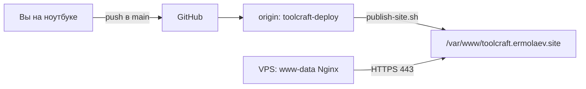

# Деплой Toolcraft на `toolcraft.ermolaev.site`

Публикация example-приложений: сборка monorepo и выкладка на origin.

Инфраструктура (DNS, SAN, Nginx) **не в этом репозитории** — локально в `G:\domains\server` (репозиторий server):

| Что | Путь в `G:\domains\server` |
| --- | --- |
| Инструкция | `servers/toolcraft.ermolaev.site.md` |
| Origin vhost | `servers/home-nginx/sites-available/toolcraft.ermolaev.site` |
| VPS vhost | `servers/vps-nginx (https)/sites-available/toolcraft.ermolaev.site` |

Правки nginx — там, затем копирование на origin/VPS и `nginx -t` + reload. Workflow и `scripts/publish-site.sh` в toolcraft только собирают и кладут статику в `/var/www/toolcraft.ermolaev.site`.

## Цель

| Что | Значение |
| --- | --- |
| Домен | `toolcraft.ermolaev.site` |
| URL каталога | `https://toolcraft.ermolaev.site/` |
| URL приложения | `https://toolcraft.ermolaev.site/<имя-папки>/` |
| Пример | `https://toolcraft.ermolaev.site/glass/` |
| Origin root | `/var/www/toolcraft.ermolaev.site/` |
| Nginx-конфиги / DNS | `G:\domains\server` (см. таблицу выше) |
| Выкладка | GitHub Actions → self-hosted runner на origin (`toolcraft-deploy`) |

Каталог на `/`, демо на `/<папка>/`. Старые URL `/demos/…` на origin редиректят без префикса. CI собирает каждый example с `--base /<папка>/`. Отдельные `vercel.json` у examples по-прежнему могут указывать `/demos/<папка>/` для Vercel — сайт их не использует: `scripts/build-examples.mjs` передаёт `--base` через CLI. Подписанный `vite.config.ts` для этого не правят: аргумент CLI перекрывает `base` в конфиге.

Сначала один раз поднимите сайт по инструкции в server (DNS → origin vhost → VPS certbot/HTTPS), затем этот файл.

---

## Кто и где (приложение)

| Роль | Где | Учётка | Что делает |
| --- | --- | --- | --- |
| Вы | ноутбук / GitHub | — | правки, push в `main`, проверка в браузере |
| Runner выкладки | Origin | `toolcraft-deploy` | `pnpm` build + `scripts/publish-site.sh` → `/var/www/toolcraft.ermolaev.site/` |
| Nginx | origin / VPS | `www-data` | см. server-инструкцию |

SSH на origin — **только с LAN** (`10.0.0.0/24`). GitHub-hosted runner до origin не достучится.

---

## 0. Предусловия

- Инфраструктура `toolcraft.ermolaev.site` уже настроена (server-инструкция)
- Monorepo с корневым `pnpm install` (workspace: `starter` + `examples/*`)
- Репозиторий на GitHub (`detailcore/toolcraft`); после п. 1 push в `main` сам собирает и выкладывает сайт

---

## 1. Пользователь и runner на origin (один раз)

**Сервер:** Origin.  
**Кто:** ваша SSH-учётка **с sudo** с LAN; runner ставится под `toolcraft-deploy`.

### 1.1 Пользователь и каталог сайта

```bash
sudo adduser --disabled-password --gecos '' toolcraft-deploy

sudo mkdir -p /var/www/toolcraft.ermolaev.site
sudo chown -R toolcraft-deploy:www-data /var/www/toolcraft.ermolaev.site
sudo chmod -R u+rwX,g+rX,o+rX /var/www/toolcraft.ermolaev.site
```

Пишет только **`toolcraft-deploy`**, без `sudo`. Отдельного sudoers не нужно.  
Nginx читает от **`www-data`**.  
Права нужны только на каталог сайта: служебные `.staging.*`, `.previous.*`, `.activating.*`, `.failed.*`, `.publish-incoming` и `.publish-parked` появляются внутри него. Владельца `/var/www` менять не нужно.

На origin уже должен быть Node (как для `uno`); job дополнительно ставит Node 24 и pnpm 12 через Actions от имени `toolcraft-deploy`.

### 1.2 Self-hosted runner

1. GitHub: репозиторий `detailcore/toolcraft` → **Settings → Actions → Runners → New self-hosted runner** → Linux x64 → token.
2. На origin под **`toolcraft-deploy`**:

```bash
# SSH или: sudo -iu toolcraft-deploy
cd /home/toolcraft-deploy
mkdir -p actions-runner && cd actions-runner
# скачайте и распакуйте runner по инструкции GitHub, затем:
./config.sh --url https://github.com/detailcore/toolcraft --token <TOKEN> --labels toolcraft-deploy
```

3. Сервис (**ваша SSH + sudo** на origin, из каталога runner):

```bash
sudo ./svc.sh install toolcraft-deploy
sudo ./svc.sh start
```

Проверка в GitHub UI: Settings → Runners → **Idle**, метка `toolcraft-deploy`.

`detailcore/toolcraft` как форк — это **ваш** репозиторий; runner вешается на него. Опасны чужие PR **в ваш** репозиторий с запуском workflow на self-hosted runner. Сейчас workflow только `push` в `main` и `workflow_dispatch`. Job выполняется лишь при `github.ref == refs/heads/main`: ручной запуск с другой ветки пропускается. В Settings → Actions не включайте выполнение workflow из fork PR; чужие PR в `main` не мержите без ревью.

---

## 2. Что делает workflow



Файл [`.github/workflows/deploy.yml`](../.github/workflows/deploy.yml):

| Триггер | Действие |
| --- | --- |
| `push` в `main` (paths: examples, lockfile, `scripts/publish-site.sh`, тесты публикации, `scripts/build-examples.mjs`, workflow) | сборка + выкладка |
| `workflow_dispatch` с ветки `main` | то же вручную; с другой ветки job пропускается |

Шаги на runner:

1. `actions/checkout@v7`
2. `pnpm/action-setup@v6` + `actions/setup-node@v7` (pnpm 12, Node 24)
3. `bash scripts/publish-site.test.sh`
4. `pnpm install --frozen-lockfile`
5. `pnpm run build:examples` — `scripts/build-examples.mjs`, по два example сразу (`BUILD_CONCURRENCY`, по умолчанию 2); каждому передаётся `--base /<папка>/`
6. `SITE_ROOT=… SITE_URL=… bash scripts/publish-site.sh` — проверка `dist` и URL скрипта/стиля, сборка `dist-site/`, замена управляемых файлов в корне сайта, smoke

`SITE_ROOT` и `SITE_URL` задаются в workflow. Без них скрипт не публикует. `SITE_ROOT` — абсолютный путь без завершающего слэша, не `/` и без сегментов `.` / `..`. Каталог уже должен существовать, быть обычной директорией (не symlink) и быть доступным на запись. `SITE_URL` — origin без пути, например `https://toolcraft.ermolaev.site`.

Выкладка меняет в `$SITE_ROOT` каталог `index.html`, папки демо, маркеры `.publish-ok` / `.publish-demos` и убирает устаревший `demos/` при наличии. Перед переносом скрипт записывает план `.publish-incoming` (по одному slug на строку) и не двигает запись, которая лежит на другой файловой системе, чем `SITE_ROOT`. Staging — `$SITE_ROOT/.staging.<pid>`, промежуточный activate — `$SITE_ROOT/.activating.<pid>`, предыдущее дерево — `$SITE_ROOT/.previous.<pid>`. Файл `.publish-parked` появляется, когда старые записи уже целиком лежат в previous. Обрыв после начала переноса возвращает это дерево: ловушка `EXIT` делает это сразу, следующий запуск — если процесс умер без ловушки. Пока на корне нет `.publish-ok`, единственный `.previous.*` восстанавливается заменой каталогов, а не удаляется. Живой `demos/.publish-ok` без `.publish-incoming` — уже выложенный старый сайт: снимок удаляется, `demos/` не разбирается. Несколько `.previous.*` без маркера успеха — ошибка, каталоги не трогаются. Smoke идёт по `SITE_URL` до удаления previous. Сначала пишется `.publish-demos`, затем `.publish-ok`, и только после успешного smoke.

Smoke: `/` отдаёт каталог со ссылками `/{name}/`, затем каждая демо-страница и **каждый** её `script`/`link` под `/{name}/`. Ответ ассета не должен быть HTML: ни по `Content-Type`, ни телом, совпадающим с оболочкой демо. Ошибка smoke возвращает предыдущее дерево. Новый push в `main` **не** отменяет уже идущую выкладку (`cancel-in-progress: false`).

На origin: `/` → `index.html` каталога; `/demos` и `/demos/…` → 301 на путь без префикса; отсутствующий `.js`/`.css` и прочая статика должны отвечать `404`, а пути с `/.` (снимки выкладки) — `deny`. Иначе SPA отдаёт `index.html` с кодом 200, и VPS кэширует его как ассет. На VPS не должно быть пустого `location ^~ /demos/` без `proxy_pass`. После правки vhost скопируйте файл на origin и/или VPS и сделайте `nginx -t` и reload (см. server `servers/toolcraft.ermolaev.site.md`). Reload после обычной выкладки статики **не** нужен.

---

## 3. Повседневная работа

| Шаг | Где | Кто |
| --- | --- | --- |
| 1. Правки кода | ноутбук | вы |
| 2. Push / merge в `main` | GitHub | вы |
| 3. Сборка и выкладка | origin | `toolcraft-deploy` (Actions) |
| 4. Просмотр | браузер → VPS → origin | вы |

Ручной прогон без коммита: Actions → **Build and deploy** → **Run workflow** на ветке `main`. Запуск с другой ветки job пропускает.

Один example локально, без выкладки:

```bash
pnpm --filter glass run build
```

Так `base` остаётся тем, что в `vite.config` (часто `/`). Сборка, которую примет публикация сайта:

```bash
pnpm --filter glass run build -- --base /glass/
```

Новый example: папка `examples/<name>` (для сайта достаточно `package.json` и сборки через `build-examples.mjs`). `vercel.json` с `--base /demos/<name>/` можно оставить как есть для Vercel. Подписанный `vite.config.ts` не менять. Push в `main`. Отдельный vhost и DNS не нужны (см. server-инструкцию).

Локальная выкладка на origin (редко):

```bash
pnpm run build:examples
SITE_ROOT=/var/www/toolcraft.ermolaev.site \
SITE_URL=https://toolcraft.ermolaev.site \
bash scripts/publish-site.sh
```

Проверка самого скрипта публикации, без сборки examples: `pnpm test:publish-site`.

---

## 4. Проверка

После успешного workflow (и готовой инфраструктуры):

```bash
curl -sI https://toolcraft.ermolaev.site/ | head
curl -sI https://toolcraft.ermolaev.site/glass/ | head
curl -sI https://toolcraft.ermolaev.site/demos/glass/ | head
```

У `/` ожидается `200` и HTML-каталог. В браузере: `https://toolcraft.ermolaev.site/` открывает список, дальше `…/glass/`, `…/ascii/`. Старый `…/demos/glass/` отвечает `301` на `…/glass/`.

Кэш HIT на `.js`/`.css` и отсутствие долгого HIT на HTML — на стороне VPS; детали в server-инструкции.

---

## Краткий порядок

| # | Где | Что |
| --- | --- | --- |
| 1 | `G:\domains\server` | DNS + origin/VPS nginx по `servers/toolcraft.ermolaev.site.md` и файлам vhost в `home-nginx` / `vps-nginx (https)` |
| 2 | origin | `toolcraft-deploy` + self-hosted runner (этот файл, п. 1) |
| 3 | GitHub | push в `main` → workflow |
| 4 | браузер | `https://toolcraft.ermolaev.site/<folder>/` |
